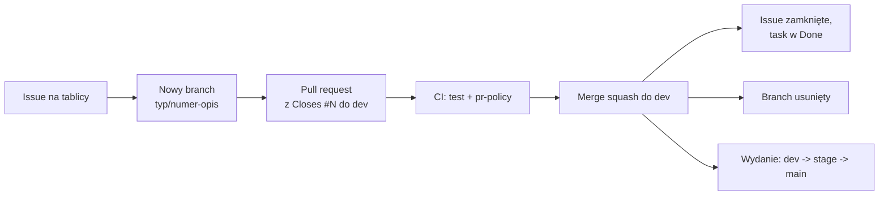

# WorthMyTime - backend

REST API (Sanic, Pydantic, SQLAlchemy async, Alembic).

## Jak pracujemy

Każda zmiana przechodzi ten sam cykl: **issue = nowy branch = pull request = merge = zamknięcie taska = usunięcie brancha**.



1. Zadanie zaczyna się od issue na [tablicy projektu](https://github.com/orgs/worthmytime/projects/1).
2. Dla issue powstaje osobny branch `<typ>/<numer>-<opis>` (np. `feature/12-reset-hasla`), z `dev`, bez commitów prosto na `dev`, `stage` ani `main`.
3. Zmiany trafiają w pull requeście, którego opis zawiera `Closes #<numer>`.
4. PR do `dev` musi przejść CI (`test`, `pr-policy`). Gałęzie `dev`, `stage` i `main` są chronione.
5. Po scaleniu (squash) do `dev` GitHub zamyka issue, przenosi zadanie do Done i usuwa branch.
6. Wydanie: `dev` -> `stage` (testy przed produkcją) -> `main` (produkcja). Do `stage` i `main` scala tylko właściciel (`poewer`).

Szczegóły i konwencje: [CONTRIBUTING.md](CONTRIBUTING.md).

## Uruchomienie lokalnie

```powershell
uv sync --python 3.12
uv run alembic upgrade head      # migracje (SQLite domyślnie, Postgres przez DATABASE_URL)
uv run -m app.main               # http://localhost:8001/api/v1/health
uv run ruff check .
uv run python -m pytest          # SQLite; TEST_DATABASE_URL=... uruchamia testy API na Postgresie
```

## Migracje (Alembic)

> Na Windowsie `uv run alembic ...` bywa blokowane ("Failed to spawn ... Odmowa dostępu"), bo system nie pozwala uruchamiać plików `.exe` z `.venv\Scripts`. Użyj wtedy `uv run python -m alembic ...` (albo `.\.venv\Scripts\python.exe -m alembic ...`). To samo dotyczy `pytest` i `ruff`.

Schemat zarządzany jest wyłącznie migracjami; aplikacja przy starcie tylko sprawdza, czy tabele istnieją.

```powershell
uv run alembic revision --autogenerate -m "opis zmiany"   # po zmianie modeli w app/models.py
uv run alembic upgrade head
uv run alembic downgrade -1
```

Baza utworzona wcześniej przez `create_all` (bez tabeli `alembic_version`): najpierw oznacz ją rewizją odpowiadającą jej schematowi, a potem zastosuj nowsze migracje. Baza sprzed `0002` (bez tabeli `budgets`):

```powershell
uv run alembic stamp 0001
uv run alembic upgrade head
```

Kontener wykonuje `alembic upgrade head` przy każdym starcie.

## Konfiguracja (`.env`, patrz `.env.example`)

| Zmienna | Opis |
|---|---|
| `DATABASE_URL` | `postgresql+asyncpg://...` lub `sqlite+aiosqlite:///./worthmytime.db` |
| `JWT_SECRET` | min. 32 znaki; przy `DEBUG=false` aplikacja nie wystartuje z domyślnym lub krótkim |
| `CORS_ORIGINS` | lista domen po przecinku (`*` tylko do rozwoju) |
| `DEBUG` | `true` luzuje wymagania produkcyjne |
| `LOG_LEVEL` | `INFO` / `DEBUG` ... |
| `RATE_LIMIT_ENABLED` | limity żądań i blokada logowania (domyślnie `true`) |
| `RATE_LIMIT_API_PER_MINUTE` / `RATE_LIMIT_AUTH_PER_MINUTE` | żądania na minutę z jednego IP: ogółem (300) i logowanie/rejestracja (20) |
| `LOGIN_MAX_FAILURES` / `LOGIN_LOCK_SECONDS` | po tylu nieudanych logowaniach na konto z jednego IP (5) blokada na tyle sekund (900) |
| `TRUST_PROXY` | `true` tylko za zaufanym reverse proxy: adres klienta z `X-Forwarded-For` |
| `COOKIE_SAMESITE` / `COOKIE_SECURE` / `COOKIE_DOMAIN` | cookie sesji (`wmt_session`, HttpOnly): `lax` przy froncie i API na tej samej stronie, `none` przy różnych domenach (wymaga HTTPS); `COOKIE_SECURE` domyślnie włączone poza `DEBUG` |
| `TYPESAFE_API_KEY` | klucz Jev (TypeSafe AI) do podpowiedzi kategorii i kolumn importu; pusty = podpowiedzi wyłączone (patrz niżej) |
| `TYPESAFE_BASE_URL` / `TYPESAFE_MODEL` | adres API Jev (domyślnie `https://api.typesafe.ai`, może wskazywać proxy) i model (domyślnie `jev-latest`) |
| `RATE_LIMIT_AI_PER_MINUTE` | prośby o podpowiedź Jev na minutę z jednego IP (20) |
| `FEATURE_FLAGS` | przełączniki funkcji po przecinku, np. `reports,tags=false` (patrz niżej) |
| `PORT` | domyślnie 8001 (w kontenerze 8000) |

Pełny stack (db + api + web): `docker compose up --build` w katalogu nadrzędnym (wymaga `JWT_SECRET`).

## Jev (TypeSafe AI)

Podpowiedzi kategorii wydatków i rozpoznawanie kolumn pliku importu robi Jev. **Klucz API jest tylko w backendzie**: frontend woła `POST /api/v1/ai/categorize` i `POST /api/v1/ai/map-columns`, a backend przekazuje pytanie do Jev (`app/jev.py`). W przeglądarce ani w kontenerze frontendu klucza nie ma.

- Ustaw `TYPESAFE_API_KEY` w `.env` backendu (docker-compose podaje go kontenerowi jako zmienną środowiskową; klucz nie jest wbudowywany w obraz). Bez klucza endpointy zwracają 503, a frontend przechodzi na dopasowanie bez Jev.
- `TYPESAFE_BASE_URL` może wskazywać proxy LiteLLM z repozytorium `worthmytime-infrastructure` (`http://litellm:4000/typesafe`); wtedy `TYPESAFE_API_KEY` to wirtualny klucz LiteLLM, a prawdziwy klucz Jev zna tylko proxy.
- Endpointy działają też bez konta (import wyciągu nie wymaga logowania), dlatego mają własny limit `RATE_LIMIT_AI_PER_MINUTE` i ograniczenia rozmiaru wejścia: do 60 opisów albo 30 kolumn z kilkoma przykładami na żądanie.
- **Wywiad o sytuacji życiowej** (`GET/PUT /profile/context`: mieszkanie, transport, praca, sprzęt, oszczędności, zwierzęta, zdrowie i rozwój oraz własne kategorie użytkownika) zamieniany jest na zdania (`app/life.py`) i dołączany do pytania o kategorię dla zalogowanego użytkownika, np. „Mieszka z rodzicami: nie płaci czynszu najmu ani raty za mieszkanie.”. Wszystkie pola są opcjonalne.
- Do Jev trafiają tylko opisy wydatków, zdania z wywiadu (odpowiedzi z list i własny dopisek użytkownika) oraz nagłówki i przykładowe wartości kolumn. W logach zapisujemy sam rodzaj błędu, bez treści zapytania.

## Asystent AI

Czat, który zna bieżący miesiąc użytkownika i podpowiada, jak pokierować wydatkami, żeby pieniędzy wystarczyło do końca miesiąca (`POST /api/v1/assistant/chat`, tylko po zalogowaniu). **Klucz i nazwa modelu są tylko w backendzie.**

| Zmienna | Opis |
|---|---|
| `ASSISTANT_API_KEY` | klucz do API modelu; pusty = asystent wyłączony (endpoint zwraca 503) |
| `ASSISTANT_MODEL` | nazwa modelu, np. `gpt-4o-mini`; wymagana |
| `ASSISTANT_BASE_URL` | adres API zgodnego z OpenAI Chat Completions, domyślnie `https://api.openai.com/v1`; może wskazywać proxy LiteLLM (`http://litellm:4000/v1`) albo innego dostawcę |

- Przy każdym pytaniu serwer składa aktualne podsumowanie miesiąca (`app/assistant.py`): dochód, budżet i wydatki kategorii, raty, prognoza, dziesięć największych wydatków, stałe wydatki, cele i wywiad o sytuacji życiowej. `GET /api/v1/assistant/context` zwraca te same zdania, żeby użytkownik widział, co wysyłamy.
- **Te dane i treść rozmowy trafiają do zewnętrznego dostawcy modelu.** Nie wysyłamy e-maila ani identyfikatorów konta.
- Rozmowa nie jest zapisywana na serwerze; historię trzyma przeglądarka i odsyła ją przy każdym pytaniu (do 30 wiadomości).
- Asystent korzysta z limitu `RATE_LIMIT_AI_PER_MINUTE`. W logach zapisujemy sam rodzaj błędu, bez treści rozmowy.

## Przełączniki funkcji (feature flags)

Nowy moduł można wdrożyć wyłączony i włączyć później samą zmianą konfiguracji. Flagi ustawia zmienna `FEATURE_FLAGS`, a aplikacja czyta ją przy starcie, więc po zmianie wystarczy restart kontenera (bez nowego obrazu).

- Format: nazwy po przecinku, np. `FEATURE_FLAGS=reports,tags=false`. Sama nazwa oznacza flagę włączoną; wartości to `true`/`false`, `1`/`0`, `on`/`off`.
- Nazwa: małe litery, cyfry, `_` i `-`, do 40 znaków. Niepoprawny wpis jest pomijany, a przy `DEBUG=false` aplikacja z nim nie wystartuje.
- Odczyt: `GET /api/v1/features` (bez logowania) zwraca `{"features": {"reports": true, "tags": false}}`. Flagi, której nie ma w odpowiedzi, frontend traktuje jak wyłączoną.
- W kodzie backendu: `settings.feature_flag_map.get("reports", False)`.

Flagi są jawne (endpoint jest publiczny), więc nie nadają się do ukrywania czegokolwiek poufnego.

## Kopie zapasowe i monitoring

Skrypty kopii zapasowej, test odtworzenia i monitoring `/health`: [ops/README.md](ops/README.md).

## Kwoty i zaokrąglenia

Zaokrąglamy w jednym miejscu (`app/money.py`): **ROUND_HALF_UP** na zapisie dziesiętnym (2,675 daje 2,68, a 2,5 daje 3; wbudowane `round()` zaokrągla do parzystej i myli się na liczbach binarnych). Kwoty w bazie to `NUMERIC(14,2)`, stawka godzinowa `NUMERIC(14,4)`; w API nadal są zwykłymi liczbami JSON. Kwoty z żądań są zaokrąglane do groszy przed walidacją.

## Przenoszenie środków (rollover)

Dla każdej kategorii budżetu można włączyć przenoszenie niewykorzystanych środków na kolejny miesiąc (`PUT /budget`, pole `rollover`, np. `{"FUN": true}`; pominięte pole zostawia ustawienie bez zmian). `GET /budget` zwraca `rollover` (włączone kategorie) i `rollover_amounts` (kwoty przeniesione na bieżący miesiąc), a `amounts` i `available` już je uwzględniają, tak samo jak prognoza, alerty i analiza zakupu.

Sposób liczenia (`rollover_amount` w `app/budget.py`):

- Liczymy od miesiąca włączenia opcji. W tym miesiącu przeniesienie wynosi 0, pierwsza kwota pojawia się w następnym.
- Po każdym pełnym miesiącu: `przeniesienie = budżet + poprzednie przeniesienie - wydane`, czyli niewykorzystane środki kumulują się z miesiąca na miesiąc.
- **Przekroczenie nie przechodzi na minus.** Wydanie ponad budżet zeruje przeniesienie, ale nie pomniejsza budżetu kolejnego miesiąca.
- **Limit:** przeniesienie nie przekracza jednego miesięcznego budżetu kategorii, więc budżet miesiąca jest najwyżej podwojony.
- Wstecz sięgamy najwyżej 12 pełnych miesięcy. Wyłączenie opcji kasuje przeniesienie; ponowne włączenie liczy od nowa.
- Budżet minionych miesięcy liczymy z **dzisiejszego** dochodu, podziału procentowego i rat (historii planu nie przechowujemy). W Potrzebach raty kredytów liczą się jako wydane w każdym miesiącu.

## Sesja w cookie i CSRF

Logowanie i rejestracja ustawiają cookie `wmt_session` (JWT, HttpOnly) oraz `wmt_csrf` (odczytywalne dla JS). Żądania zmieniające dane (`POST/PUT/DELETE`) uwierzytelnione cookie muszą odesłać wartość `wmt_csrf` w nagłówku `X-CSRF-Token` (inaczej 403). Nagłówek `Authorization: Bearer` nadal działa i nie wymaga CSRF (klienci API). `POST /auth/logout` czyści cookie, a `POST /auth/session` wymienia ważny token Bearer na cookie (migracja z localStorage). CORS z `credentials` działa tylko dla domen z `CORS_ORIGINS`, nigdy dla `*`; przeglądarka z frontendu musi wysyłać żądania z `credentials: "include"`.

## Dokumentacja API (OpenAPI i Swagger)

Po uruchomieniu serwera:

- **Swagger UI:** `http://localhost:8001/api/v1/docs` (interaktywna dokumentacja z przyciskiem *Authorize* dla tokenu Bearer; skrypty UI ładują się z CDN, więc potrzebny jest internet w przeglądarce)
- **Specyfikacja OpenAPI 3.1 (JSON):** `http://localhost:8001/api/v1/openapi.json` (np. do importu w Postmanie lub generowania klienta)

Schematy żądań powstają z modeli Pydantic (`app/schemas.py`), a opisy operacji, odpowiedzi i kody błędów są w tabeli `OPERATIONS` w `app/openapi.py`. **Dodajesz lub zmieniasz endpoint? Dopisz go do tej tabeli**: test `tests/test_openapi.py` sprawdza, że każdy zarejestrowany endpoint jest opisany (i odwrotnie), a specyfikacja przechodzi walidację OpenAPI 3.1.

## Obrazy Docker (GHCR)

Obraz buduje workflow `Publish Docker image to GHCR` (po zielonych testach), bez wdrożenia na serwer:

| Gałąź | Środowisko | Tag obrazu |
|---|---|---|
| `main` | produkcja | `<SHA commita>` |
| `stage` | testy przed produkcją | `stage-<SHA commita>` |

Tagi są zawsze po SHA (nigdy `latest`), więc wiadomo dokładnie, jaki kod działa.
Ręczne uruchomienie (`workflow_dispatch`) zbuduje wybraną gałąź z tagiem `<gałąź>-<SHA>`.
